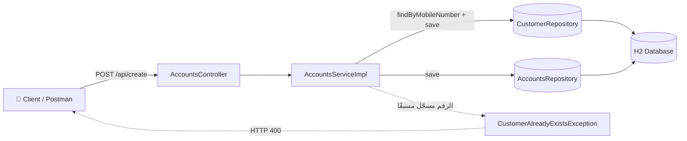

<div align="center">

# 🏦 Bank-System

### نظام مصرفي مبني على Spring Boot — خدمة إدارة الحسابات (Accounts Microservice)


**إنشاء عميل وحساب بنكي جديد بطلب واحد (REST API) 🚀**

</div>

---

<div dir="rtl">

## 📖 نبذة عن المشروع

**Bank-System** مشروع تطبيقي يوضّح بناء خدمة **RESTful** لإدارة الحسابات البنكية باستخدام **Spring Boot** وبنية طبقية واضحة (Controller ← Service ← Repository ← Database).

عند إرسال بيانات العميل، تقوم الخدمة بما يلي:

1. التحقق من أن رقم الجوال غير مسجّل مسبقًا.
2. حفظ بيانات العميل في قاعدة البيانات.
3. إنشاء حساب **توفير (Savings)** جديد مرتبط بالعميل برقم حساب عشوائي.

---

## ✨ المميزات

| الميزة | الوصف |
|---|---|
| 🧾 **إنشاء حساب** | نقطة نهاية واحدة تنشئ العميل والحساب معًا |
| 🔒 **منع التكرار** | رفض أي عميل برقم جوال مسجّل مسبقًا (HTTP 400) |
| 🕒 **Auditing** | تسجيل تلقائي لتواريخ الإنشاء والتعديل عبر `JPA Auditing` |
| 🧩 **فصل الطبقات** | استخدام DTOs وMappers بدل كشف الـ Entities مباشرة |
| 🗄️ **قاعدة H2** | قاعدة بيانات داخلية مع واجهة H2 Console للتجربة السريعة |
| 📈 **Actuator** | جاهز لمراقبة حالة التطبيق |

---

## 🛠️ التقنيات المستخدمة

- ☕ **Java 21**
- 🍃 **Spring Boot 4.1.1** (Web MVC, Data JPA, Validation, Actuator, DevTools)
- 🗃️ **H2 Database** (في الذاكرة)
- 🧰 **Lombok**
- 📦 **Maven**
- 📮 **Postman** (مجموعة طلبات جاهزة في المستودع)

---

## 🏗️ هيكلة المشروع

</div>



<div dir="rtl">

### 📁 تنظيم الحزم

```text
Accounts/src/main/java/com/sherif/Accounts
├── controller/   → نقاط النهاية (REST Controllers)
├── service/      → منطق العمل (Business Logic)
├── repository/   → الوصول لقاعدة البيانات (Spring Data JPA)
├── entity/       → كيانات قاعدة البيانات (Customer, Accounts, BaseEntity)
├── dto/          → كائنات نقل البيانات
├── mapper/       → التحويل بين DTO و Entity
├── exception/    → الاستثناءات والمعالجة المركزية للأخطاء
├── audit/        → تحديد المستخدم الحالي لعمليات Auditing
└── constant/     → الثوابت (الرسائل، النوع، العنوان)
```

---

## ⚙️ طريقة التشغيل

### المتطلبات
- JDK 21 أو أحدث
- Maven (أو استخدم `mvnw` المرفق)

### الخطوات

</div>

```bash
# 1) استنساخ المستودع
git clone https://github.com/Sherif-toiema22/Bank-System.git

# 2) الدخول لمجلد المشروع
cd Bank-System/Accounts

# 3) التشغيل
./mvnw spring-boot:run        # Linux / macOS
mvnw.cmd spring-boot:run      # Windows
```

<div dir="rtl">

سيعمل التطبيق على العنوان: **`http://localhost:8080`**

> 💡 واجهة قاعدة البيانات متاحة على: `http://localhost:8080/h2-console`
> رابط الاتصال: `jdbc:h2:mem:testdb` — المستخدم: `sa` — كلمة المرور: فارغة

---

## 📡 توثيق الـ API

### ➕ إنشاء حساب جديد

`POST` &nbsp; `/api/create`

**جسم الطلب (Request Body):**

</div>

```json
{
  "name": "Sherif",
  "email": "sherif@example.com",
  "mobileNumber": "01000000000"
}
```

<div dir="rtl">

**الاستجابة الناجحة — `201 Created`:**

</div>

```json
{
  "statusCode": "201",
  "statusMsg": "Account created successfully"
}
```

<div dir="rtl">

**عند تكرار رقم الجوال — `400 Bad Request`** ❌

**تجربة سريعة عبر cURL:**

</div>

```bash
curl -X POST http://localhost:8080/api/create \
  -H "Content-Type: application/json" \
  -d '{"name":"Sherif","email":"sherif@example.com","mobileNumber":"01000000000"}'
```

<div dir="rtl">

> 📮 يمكنك أيضًا استيراد الملف `Accounts.postman_collection.json` إلى Postman لتجربة الطلب مباشرة.

---

## 🗄️ نموذج البيانات

| الجدول | الأعمدة الرئيسية |
|---|---|
| **customer** | `customer_id` (PK) · `name` · `email` · `mobile_number` |
| **accounts** | `account_number` (PK) · `customer_id` · `account_type` · `branch_address` |

> كلا الجدولين يرثان حقول التدقيق: `created_at` · `created_by` · `updated_at` · `updated_by`

---

## 🗺️ خطة التطوير (Roadmap)

- [x] إنشاء عميل وحساب
- [ ] الاستعلام عن بيانات الحساب
- [ ] تعديل بيانات العميل
- [ ] حذف الحساب
- [ ] التحقق من المدخلات (Validation)
- [ ] معالجة شاملة للأخطاء (Global Exception Handling)
- [ ] اختبارات الوحدة والتكامل
- [ ] توثيق الـ API باستخدام Swagger / OpenAPI
- [ ] الانتقال لقاعدة بيانات دائمة (PostgreSQL / MySQL)

---

## 🤝 المساهمة

المساهمات مرحّب بها! افتح **Issue** لاقتراح فكرة أو أرسل **Pull Request**.

---

## 👨‍💻 المطوّر

**Sherif Toiema** — [@Sherif-toiema22](https://github.com/Sherif-toiema22)

إذا أعجبك المشروع، لا تنسَ دعمه بنجمة ⭐

</div>

<div align="center">

صُنع بـ ❤️ باستخدام Spring Boot

</div>